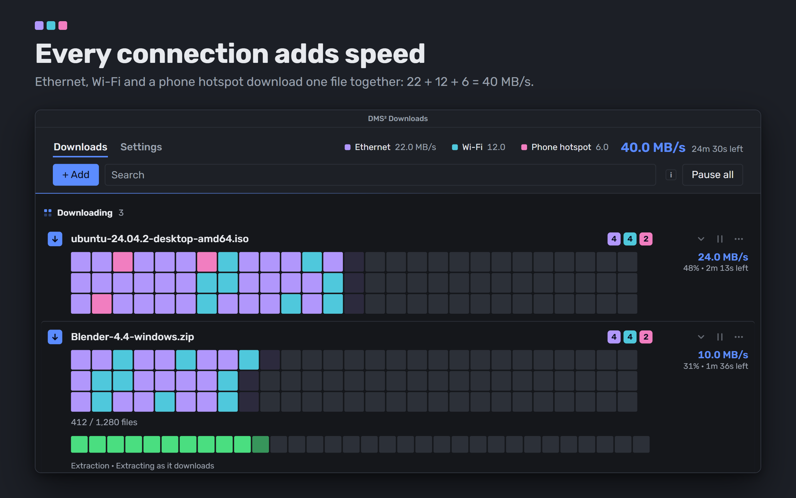
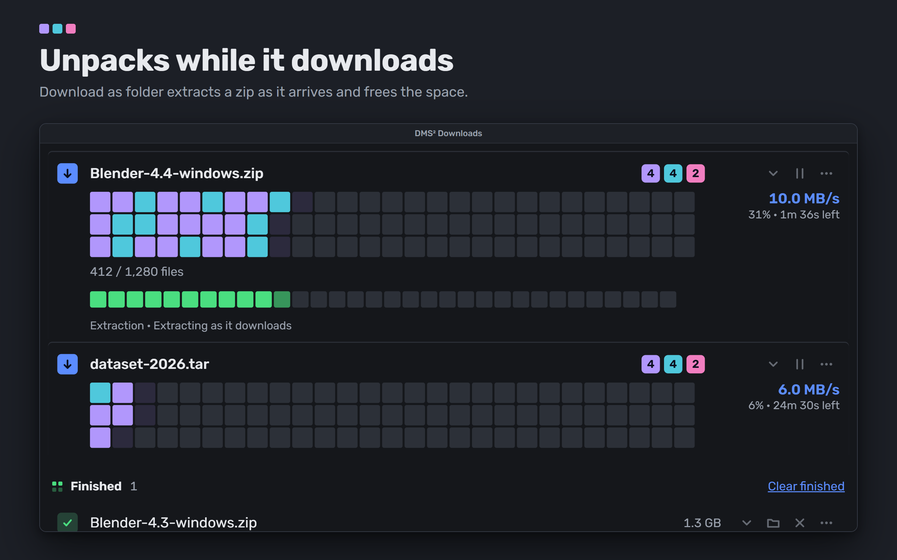
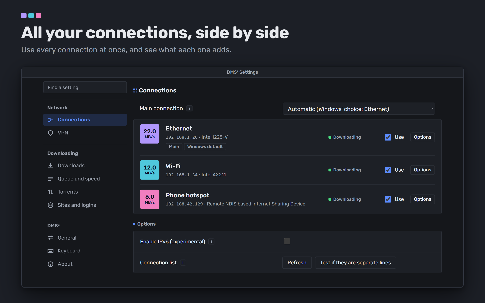
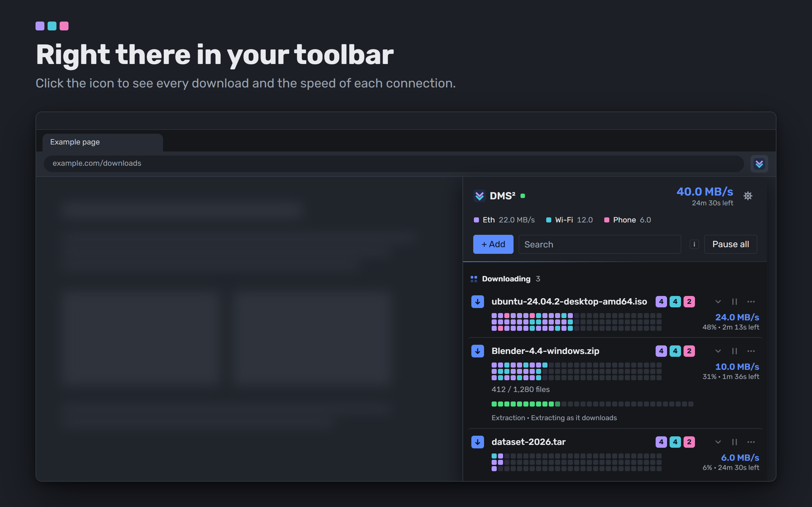
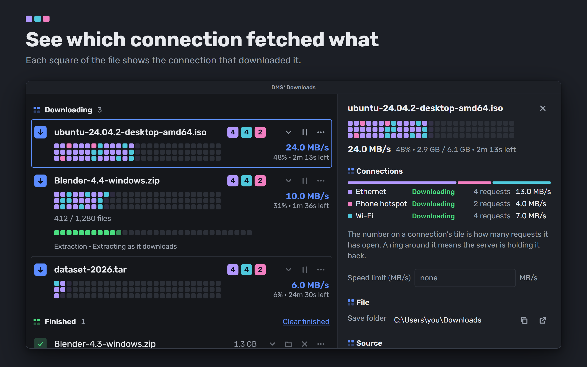

<h1 align="center">downloadmanagersquared (DMS²)</h1>

<b>Download one file over all your internet connections at once, and their speeds add up.</b>

<b><a href="https://github.com/unicrncndms/downloadmanagersquared/releases/latest">Download for Windows</a></b> · <a href="#install">Install</a> · <a href="docs/guide.md">Guide</a> · <a href="docs/benchmarks/README.md">Benchmarks</a>

Plug a phone hotspot or a second line in next to your home connection. DMS² splits every download across them: a 300 Mbit/s line plus a 100 Mbit/s hotspot downloads at close to 400 Mbit/s.

For Windows 10/11 with Firefox, LibreWolf, Waterfox, Floorp, Chrome or Edge. Free and open source (MIT). No account, no server, no telemetry.

## What makes it different

**1. It adds up connections, per file.**
Other download managers open many requests over one connection. DMS² fetches the pieces of one file over every connection you have, at the same time. A faster connection takes over more of the work, nothing is downloaded twice, and a download survives crashes, sleep and restarts.

**2. It works with file hosts that give each IP address its own link.**
Most managers fail here, because a link fetched over one connection doesn't work over another. DMS² opens the site once per connection, repeats the clicks you made the first time, and takes each connection's own link.

**3. It extracts archives while they download, and needs far less disk space.**
With *Download as folder*, a `.zip`, `.7z` or `.rar` is unpacked as its bytes arrive, and each extracted part of the archive is deleted at once. You get the folder, never the archive. A 100 GB archive that extracts to 140 GB needs about 140 GB of free space instead of 240 GB. Split archives (`.part1.rar`, `.7z.001`, `.z01` …) extract as one, part after part.

**4. A VPN per connection, without admin rights.**
Each connection can get its own WireGuard tunnel. The tunnels run inside DMS², so no driver is installed and your other programs aren't affected.

## Will it make my downloads faster?

Only if your connections are really separate lines: your home connection plus a phone hotspot, two internet providers, or a second router on another line.

- Wi‑Fi and Ethernet to the same router share one line. Together they are no faster than either.
- A download can't go faster than the server sends. A server that limits each download to a slow speed limits each connection to it too, though DMS² opens several requests per connection.

**Measured:** a 1.3 GB file, a Wi‑Fi line and a 5G phone tethered by USB, DMS² 0.8.0.

| | Speed | Time |
|---|---|---|
| Wi‑Fi alone | 135 Mbit/s | 78 s |
| 5G tether alone | 94 Mbit/s | 112 s |
| **DMS² over both** | **229 Mbit/s** | **46 s** |

The two lines added up to 229 Mbit/s, and DMS² reached 229. One run, each line measured alone with one request just before; lines vary from run to run. The file, the method and every row are in [docs/benchmarks](docs/benchmarks/README.md), with a script to measure your own lines.

## Install

Open source (MIT) and built by GitHub Actions: every release is [attested](#privacy-and-security), so you can check that the files come from this source. The program isn't code-signed, so Windows asks you to confirm.

1. Download `downloadmanagersquared-windows.zip` from the [latest release](https://github.com/unicrncndms/downloadmanagersquared/releases/latest) and open it. Extracting it is optional.
2. Run `dms-engine.exe`. If Windows says it might depend on other files in the zip, choose **Run**: it carries what it needs. SmartScreen warns because the program isn't code-signed: **More info → Run anyway**.
3. Pick the install folder (Program Files by default) and shortcuts, then **Install**. Windows asks for administrator rights only if the folder needs them.
4. Click **Add to …** for your browser and confirm.

DMS² then runs in the tray. In Firefox the extension asks to enable containers, which it uses to open sites through one connection at a time; in Chrome and Edge, DMS² opens those sites in its own browser window.

Then download a file of 100 MB or more as usual, or use *Download with DMS²* on a link's menu. Everything else is in the **[guide](docs/guide.md)**: adding downloads, connections, sites with a link per IP, Download as folder, torrents, FTP and SFTP, checksums, settings, VPN, several browsers, upgrade and uninstall, and what to do when something goes wrong.

## Everything else it does

- **Takes over your browser's downloads.** Download as usual: files over 100 MB, magnet links, `.torrent` and Metalink (`.meta4`) files go to DMS² by themselves.
- **Torrents** over all connections too.
- **SFTP.** Paste an `sftp://user@host/path` link (with `:password` in it, or a key file in the box's Options): one SSH session per connection, each reading its part, over every connection. The first time a server is met you are asked to trust its key fingerprint, before any login is sent; a changed key fails the link with a warning. Logins are kept encrypted and can be removed in Settings.
- **FTP and FTPS.** Paste an `ftp://` or `ftps://` link into Add download (or click one on a page): it downloads over every connection like any file, anonymously unless the link carries a login. The password is kept encrypted and never shown. Plain `ftp://` is unencrypted.
- **Mirrors.** A Metalink, or a server that names mirrors with a checksum, lets each connection fetch from its own mirror, so one slow mirror doesn't hold back the rest. A mirror serving another file is dropped.
- **Checksums.** Paste a SHA-256 or MD5, and the file is checked when it finishes.
- **A queue you control.** Drag downloads into order or use the arrows. Drop a waiting download on a running one to take its place.
- **IPv6 (experimental, off by default).** A connection with only IPv6, such as some phone tethers, is added up too. Never tried on a real carrier network with NAT64/DNS64 or 464XLAT.

## Limitations

- Windows only. Browsers: Firefox-based ones, Chrome and Edge.
- IPv6 is experimental and off by default. Inside VPN tunnels it's IPv4 only, torrents get no port forwarding over IPv6, and on an IPv6-only connection a link with a bare IPv4 address fails (there is no NAT64 prefix discovery).
- Replayed clicks are synthetic: sites that only accept real clicks ask every time.
- Links a site creates through a form POST can't be fetched again.
- Servers that fingerprint TLS may refuse DMS² despite your browser's User-Agent.
- A torrent with the VPN set to Off shows its peers the IP address of every connection it uses. That's why DMS² asks about the VPN before such a torrent starts.

## Privacy and security

DMS² has no server and collects nothing; see [PRIVACY.md](PRIVACY.md), which also lists what each extension permission is used for. It only accepts requests from your own Windows user, and its proxies only reach the internet, never your local network. It doesn't protect you from programs running as you, or from the PC's administrators. To report a vulnerability, see [SECURITY.md](SECURITY.md).

The programs aren't code-signed, but each release's zip, `dms-engine.exe` and `dms-host.exe` carry a GitHub attestation of the workflow run and commit that built them. To check a download, run `gh attestation verify <file> --repo unicrncndms/downloadmanagersquared`.

## Contributing

How the engine and extension fit together, building and tests: [CONTRIBUTING.md](CONTRIBUTING.md). Terms used in the code and docs are in [CONTEXT.md](CONTEXT.md), decisions in [docs/adr/](docs/adr/).

## Licence

MIT, see [LICENSE](LICENSE). The zip's `THIRD-PARTY-NOTICES` lists the engine's libraries and their licences.
